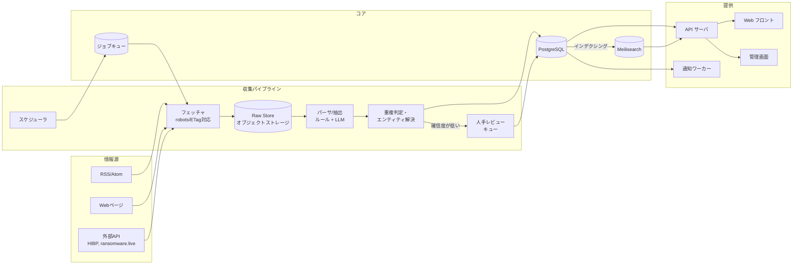

# 情報漏洩情報 集約プラットフォーム 設計書（v0.1 ドラフト）

最終更新: 2026-10-17
ステータス: ドラフト（レビュー待ち）

---

## 0. この文書の目的

情報漏洩（データブリーチ）に関する公開情報を一箇所に集約し、検索・追跡・通知できるプラットフォームの初期設計をまとめる。
技術選定の根拠とトレードオフ、MVP の範囲、将来見直すべき点を明示する。

---

## 1. スコープと前提

### 1.1 扱う情報（スコープ内）

| 種別 | 例 |
|---|---|
| 企業・組織の公式発表 | プレスリリース「不正アクセスによる個人情報漏えいの可能性について」など |
| 監督官庁・公的機関の公表 | 個人情報保護委員会（PPC）、金融庁、IPA、JPCERT/CC、米 HHS Breach Portal、州司法長官の通知一覧 |
| 報道・専門メディア | Security NEXT、piyolog、ScanNetSecurity、BleepingComputer、The Record など |
| 既存の漏洩メタデータ DB | Have I Been Pwned（HIBP）の breach 一覧 API |
| ランサムウェアリークサイトの観測情報 | ransomware.live 等が公開している「被害組織名・グループ名・日付」のメタデータ |

### 1.2 扱わない情報（スコープ外）— 重要

- **漏洩したデータそのもの**（個人情報、認証情報、ダンプファイル）は収集・保存・検索対象にしない。
- ダークウェブやリークサイトの実データを取得・ミラーしない（上記のメタデータ観測のみ）。
- 個人を特定した「この人の情報が漏れた」という表示はしない。メールアドレス確認は HIBP の k-anonymity API への委譲に留める（後述）。

理由: 法的リスク（不正アクセス禁止法、個人情報保護法、不正競争防止法）と倫理面。メタデータ集約だけで利用者（セキュリティ担当者・法務・一般利用者）の課題の大半は解決できる。

### 1.3 想定ユーザーとユースケース

| ユーザー | やりたいこと |
|---|---|
| 企業のセキュリティ/法務担当 | 取引先・競合・自社グループの漏洩事案を即日把握したい。業界動向を把握したい |
| 情報システム担当 | 自社が使う SaaS ベンダーの漏洩を検知し、対応判断したい |
| 研究者・メディア | 期間・業種・原因別に事案を横断検索し、統計を取りたい |
| 一般利用者 | 自分が使っているサービスで漏洩があったか知りたい |

### 1.4 制約

- 個人開発スタート（1 名、副業時間）。初期コストは月数千円〜1 万円程度に抑える。
- 日本の事案を主、海外を従として開始する。日本語検索品質を優先する。
- 情報源は原則「公開情報」。利用規約で機械収集が禁止されているサイトは RSS/API がある場合のみ利用する。

---

## 2. 要件

### 2.1 機能要件

**MVP（最初の 2〜3 か月）**
- F1. 情報源（RSS / HTML / API）の定期クロールと、事案（Incident）への正規化
- F2. 事案の重複統合（同一事案を複数ソースから 1 件に束ねる）
- F3. 全文検索＋ファセット（組織名、業種、漏洩種別、原因、期間、件数規模、国）
- F4. 事案詳細ページ（タイムライン、出典一覧、影響データ種別、件数）
- F5. 組織ページ（過去事案の履歴）
- F6. 管理画面での人手レビュー（自動抽出結果の承認・修正）

**v1（MVP 後 3 か月）**
- F7. ウォッチリスト（組織名・キーワード・業種）と通知（メール / Slack / Webhook）
- F8. 公開 API（読み取り、API キー、レート制限）
- F9. 統計ダッシュボード（月次件数、原因別、業種別）
- F10. メールアドレス漏洩チェック（HIBP range API への委譲）

**v2 以降**
- F11. 海外ソースの拡充、多言語
- F12. 類似事案検索（ベクトル検索）
- F13. 組織の「リスクスコア」や SaaS ベンダー監視

### 2.2 非機能要件

| 項目 | 目標 |
|---|---|
| データ量 | 日本の公表事案は年 1,000〜2,000 件。海外含め 5 年で 10 万件規模。出典ドキュメントは 100 万件規模 |
| 検索レイテンシ | p95 < 300ms |
| クロール鮮度 | 主要ソースは 15〜60 分間隔。公表から 1 時間以内に掲載 |
| 可用性 | 99.5%（個人運営のため SLA は設けない） |
| 正確性 | 公開事案には必ず一次出典 URL を付ける。自動抽出のみの項目は「未確認」表示 |
| コスト | MVP 月 1 万円以内 |
| セキュリティ | 管理画面は認証必須。収集データに PII を含まないことを前提とした上で、万一混入しても保存前に落とす |

---

## 3. 全体アーキテクチャ

### 3.1 コンポーネント図



### 3.2 データフロー

1. **スケジューラ**が情報源ごとの間隔でフェッチジョブをキューに投入する。
2. **フェッチャ**が robots.txt / ETag / Last-Modified を尊重して取得し、生 HTML/JSON を**Raw Store**に保存する（再パース可能にするため原本を残す）。
3. **パーサ**が原本から「ドキュメント」（1 記事・1 発表）を作り、ルールベース（正規表現、サイト別テンプレ）と LLM 抽出で構造化フィールドを取り出す。
4. **重複判定**で既存事案との一致を判定し、既存に紐付けるか新規事案を作る。確信度が閾値未満なら**レビューキュー**へ。
5. **PostgreSQL** を正とし、変更イベントで **Meilisearch** に同期する。
6. 公開 API / Web / 管理画面は API サーバ経由でのみアクセスする。
7. 事案の新規作成・更新イベントをウォッチリストと照合し、**通知ワーカー**が配信する。

---

## 4. データモデル

### 4.1 中核エンティティ

```
Organization 1 ──< IncidentOrganization >── 1 Incident 1 ──< IncidentSource >── 1 Document ── 1 Source
                                              │
                                              ├──< IncidentDataType (漏洩したデータ種別)
                                              ├──< IncidentEvent    (タイムライン)
                                              └──< IncidentTag
```

**Incident（事案）** — ユーザーが検索する単位
| カラム | 型 | 説明 |
|---|---|---|
| id | uuid | |
| title | text | 正規化した見出し（例: 「○○社 不正アクセスによる顧客情報漏えい」） |
| summary | text | 300 字程度の要約（LLM 生成、レビュー済みフラグあり） |
| status | enum | `draft` / `published` / `merged` / `retracted` |
| cause | enum | `unauthorized_access` / `ransomware` / `misconfiguration` / `lost_device` / `insider` / `email_misdelivery` / `third_party` / `unknown` |
| affected_count | bigint null | 影響件数（判明分） |
| affected_count_is_estimate | bool | |
| occurred_at / detected_at / disclosed_at | date null | 発生 / 検知 / 公表 |
| country | char(2) | |
| industry | text | 業種（日本標準産業分類の大分類ベース） |
| confidence | numeric | 自動抽出の確信度 0〜1 |
| review_state | enum | `unreviewed` / `reviewed` / `needs_attention` |
| merged_into_id | uuid null | 統合された場合の統合先 |
| created_at / updated_at | timestamptz | |

**Organization（組織）**
- id, canonical_name, aliases(text[]), domain(s), country, industry, parent_id（グループ会社）
- 名寄せキー: 法人番号（日本）、ドメイン、正規化名称

**Source（情報源）**
- id, name, kind(`rss` / `html` / `api`), base_url, fetch_interval_sec, parser_name, trust_level(`official` / `authority` / `media` / `aggregator`), enabled, robots_policy

**Document（取得した 1 記事・1 発表）**
- id, source_id, url(unique), raw_object_key, title, published_at, fetched_at, content_hash, extracted(jsonb), lang

**IncidentSource** — Incident と Document の多対多。`role` = `primary`（一次出典）/ `secondary`

**IncidentDataType** — 漏洩したデータ種別のマスタ参照
- 例: 氏名、住所、電話、メール、生年月日、クレカ番号、口座、パスワード（ハッシュ/平文）、マイナンバー、健康情報、社内文書

**IncidentEvent（タイムライン）**
- incident_id, occurred_at, kind(`occurred` / `detected` / `disclosed` / `updated` / `report_filed` / `resolved`), description, document_id

**Watchlist / WatchlistRule / Notification**（v1）
- user_id, rule(`organization_id` | `keyword` | `industry` | `data_type`), channel(`email` / `slack` / `webhook`), last_notified_at

### 4.2 設計上の判断

- **Incident と Document を分ける。** 1 事案に対して企業発表・PPC 公表・報道が複数ぶら下がる。ユーザーは事案単位で見たいが、出典の透明性は保ちたい。
- **原本（Raw）を残す。** パーサ改善後に再抽出できる。ストレージは安価（月数十 GB で数百円）。
- **merged_into_id で統合履歴を保つ。** 誤統合の切り戻しを可能にする。
- **件数は「判明分」と「推定」を区別する。** 第一報と続報で数値が変わるのが常態。
- **confidence と review_state を分ける。** 前者は機械、後者は人の状態。

---

## 5. 収集パイプライン詳細

### 5.1 情報源の優先順位（MVP）

| 優先 | ソース | 方式 | 備考 |
|---|---|---|---|
| 1 | 個人情報保護委員会（漏えい等報告・公表） | HTML | 権威ソース。更新頻度は低め |
| 1 | Security NEXT | RSS | 日本の事案を網羅的に追える |
| 1 | piyolog | RSS | 重要事案の詳細まとめ |
| 2 | JPCERT/CC、IPA の注意喚起 | RSS | 事案より脆弱性寄りだが関連 |
| 2 | 企業プレスリリース（PR TIMES の「お詫び」「漏えい」検索、各社 IR） | RSS / HTML | タイトル正規表現でフィルタ |
| 2 | HIBP breaches API | API | 海外事案メタデータ。無料・公式 |
| 3 | ransomware.live | API | リークサイト観測メタデータ |
| 3 | 海外メディア（BleepingComputer 等） | RSS | v1 以降 |

### 5.2 抽出戦略

1. **サイト別パーサ**（優先）: 構造が安定しているサイトは CSS セレクタ / 正規表現で確実に取る。
2. **LLM 抽出**（フォールバック / 補完）: 本文から以下を JSON スキーマで抽出する。
   - 組織名、原因、影響件数、データ種別、発生日 / 検知日 / 公表日、要約
   - プロンプトには「推測しない。本文に無い項目は null」を明記し、出力をスキーマ検証する。
   - 1 ドキュメントあたり数円。月 3,000 ドキュメントでも数千円に収まる。
3. **確信度**: サイト別パーサ=0.9、LLM=0.6 を初期値とし、複数ソース一致で加算する。閾値 0.75 未満はレビューキューへ。

### 5.3 重複判定（エンティティ解決）

- 第 1 段: 同一 URL / content_hash → 同一 Document。
- 第 2 段: 組織名（名寄せ後）× 公表日 ±14 日 × 原因 の一致 → 同一 Incident 候補。
- 第 3 段: 候補が複数 / 曖昧な場合は、タイトルの類似度（trigram）と LLM による「同一事案か」判定。
- 判定結果はレビュー可能にし、誤統合は `merged_into_id` を解除して切り戻す。

### 5.4 クロールの作法

- robots.txt を遵守し、User-Agent に連絡先を含める。
- 同一ホストへの同時接続は 1、間隔は 5 秒以上。
- 条件付きリクエスト（ETag / If-Modified-Since）で帯域を節約する。
- 失敗は指数バックオフ（1 分 → 最大 6 時間）、連続失敗で `needs_attention` に。

---

## 6. API 設計（公開 API / フロント共用）

REST + JSON。認証は公開読み取りは不要（レート制限あり）、ウォッチリスト等はセッション / API キー。

| メソッド | パス | 説明 |
|---|---|---|
| GET | `/v1/incidents` | 検索。`q`, `org`, `industry`, `cause`, `data_type`, `country`, `from`, `to`, `min_count`, `sort`, `page` |
| GET | `/v1/incidents/{id}` | 事案詳細（timeline, sources, data_types を含む） |
| GET | `/v1/organizations/{id}` | 組織と事案履歴 |
| GET | `/v1/organizations?q=` | 組織サジェスト |
| GET | `/v1/stats/monthly?from=&to=&group_by=cause` | 統計 |
| GET | `/v1/sources` | 情報源一覧（透明性のため公開） |
| POST | `/v1/watchlists` | ウォッチリスト作成（要認証） |
| POST | `/v1/pwned/check` | HIBP range API へのプロキシ。ハッシュ先頭 5 文字のみ外部送信 |

管理 API（`/admin/*`）は別ルータ・別認証で、レビューキューの承認・統合・取り下げを提供する。

レスポンス例（抜粋）:

```json
{
  "id": "4f0e...",
  "title": "株式会社サンプル 不正アクセスによる顧客情報漏えい",
  "status": "published",
  "cause": "unauthorized_access",
  "affected_count": 123456,
  "affected_count_is_estimate": false,
  "disclosed_at": "2026-10-01",
  "organizations": [{"id": "...", "name": "株式会社サンプル", "industry": "小売業"}],
  "data_types": ["name", "email", "address"],
  "sources": [
    {"role": "primary", "url": "https://example.co.jp/news/...", "publisher": "株式会社サンプル", "published_at": "2026-10-01"},
    {"role": "secondary", "url": "https://www.security-next.com/...", "publisher": "Security NEXT"}
  ],
  "review_state": "reviewed"
}
```

---

## 7. 検索設計

- **エンジン**: Meilisearch を MVP から採用。理由は日本語トークナイズが標準で動く、ファセット・タイポ許容が設定不要、運用が軽い（単一バイナリ、数百 MB メモリ）。
- **インデックス**: `incidents` 1 本。検索対象フィールド = title, summary, organization_names, aliases。フィルタ属性 = cause, industry, country, data_types, disclosed_at（epoch）, affected_count。
- **同期**: PostgreSQL の更新を outbox テーブル経由でワーカーが拾い、Meilisearch に upsert する。全件再構築ジョブも用意する。
- **PostgreSQL 側**: 管理画面や厳密検索用に `pg_trgm` を組織名に張る。

OpenSearch / Elasticsearch は 10 万件規模では過剰。件数が 100 万を超えるか、集計クエリが複雑になった時点で再検討する。

---

## 8. 画面設計（UI 概要）

### 8.1 画面一覧

| 画面 | 主要素 |
|---|---|
| トップ / ダッシュボード | 直近 7 日の新着事案リスト、今月の件数・前月比、原因別の内訳、大規模事案ハイライト |
| 検索結果 | 左: ファセット（期間、原因、業種、データ種別、国、件数規模）/ 中央: 事案カード一覧（タイトル、組織、公表日、件数、原因バッジ、出典数）/ 並び替え |
| 事案詳細 | ヘッダ（組織・公表日・件数・原因）→ 要約 → タイムライン → 漏洩データ種別 → 出典一覧（一次 / 二次を区別）→ 関連事案 → 「情報の誤りを報告」 |
| 組織ページ | 基本情報、事案履歴（年表）、ウォッチ登録ボタン |
| ウォッチリスト（v1） | ルール一覧、通知先設定、通知履歴 |
| 統計（v1） | 月次推移、原因別・業種別・データ種別別のグラフ、CSV エクスポート |
| 管理画面 | レビューキュー（抽出結果と原文の並列表示、承認 / 修正 / 統合 / 却下）、情報源の稼働状況 |

### 8.2 UI の方針

- **出典を常に前面に出す。** 各数値・各日付にホバーで出典が分かる。
- **未確認情報は明示する。** 自動抽出のみの項目はグレーの「未確認」バッジを付ける。
- **速報性と正確性を両立する。** 新着は `draft` でも「速報」として一覧に出し、レビュー後に `published` へ。
- **トーンは中立・事務的。** 煽らない。組織名の扱いは公表事実に基づく。
- ダーク/ライト両対応、モバイルでファセットはドロワー化。

---

## 9. 技術スタック候補とトレードオフ

| 領域 | 第一候補 | 代替 | 判断理由 |
|---|---|---|---|
| 言語（API・ワーカー） | **Python 3.12 + FastAPI** | Go / TypeScript (Hono) | クローラ・HTML 解析・LLM SDK のエコシステムが最も厚い。収集処理が中核のため |
| フロント | **Next.js (App Router) + TypeScript** | SvelteKit | SSR で SEO（事案ページは検索流入が主）、エコシステム |
| DB | **PostgreSQL 16** | — | jsonb、trigram、堅牢性。迷う余地なし |
| 検索 | **Meilisearch** | OpenSearch / PG FTS | 7 章参照 |
| キュー | **PostgreSQL ベース（例: procrastinate）** | Redis + RQ / Celery | MVP は DB 1 台で完結させる。Redis は v1 で通知が増えたら導入 |
| オブジェクトストレージ | **Cloudflare R2 / S3** | ローカル FS | 原本保存。egress 無料の R2 が有利 |
| LLM | Claude（構造化抽出） | ローカル小型モデル | 精度とコストのバランス。月数千円 |
| ホスティング | **VPS 1 台（Docker Compose）** | Fly.io / Cloud Run | 月 1〜2 千円。10 万件規模なら十分 |
| 監視 | Uptime Kuma + 構造化ログ + Sentry 無料枠 | Datadog | コスト |

**Go を選ばない理由**: API だけなら Go が軽快だが、パーサ・LLM 連携を別言語で書くと保守コストが倍になる。1 人開発では単一言語が優先。
**TypeScript 一本化を選ばない理由**: 有力な選択肢だが、スクレイピングと LLM 周辺の成熟度で Python が一歩先。フロントが Next.js なのでどちらにせよ TS は書く。

---

## 10. スケールと信頼性

- **負荷見積**: 公開時の想定は 1 日 1,000〜5,000 PV、検索 QPS < 1。クロールは 1 日数千リクエスト。VPS 1 台で余裕。
- **スケール経路**: フロント（Vercel/Cloudflare Pages）→ API（複数インスタンス + Postgres マネージド化）→ Meilisearch 分離、の順で切り出す。設計上、各コンポーネントは最初から別プロセスにしておく。
- **バックアップ**: Postgres は日次 pg_dump を R2 へ。Raw Store がある限り Meilisearch は再構築可能。
- **障害時の振る舞い**: Meilisearch 停止時は Postgres の `ILIKE` + trigram 検索へフォールバック（品質は落ちるが止めない）。LLM API 停止時はルール抽出のみで `confidence` を下げて登録。
- **監視項目**: ソース別の最終成功時刻（SLA: 想定間隔 × 3 を超えたらアラート）、レビューキュー滞留数、抽出失敗率、API p95。

---

## 11. 法務・倫理・運用ポリシー

- **掲載基準**: 組織自身・監督官庁・信頼できる報道のいずれかが公表した事案のみ。噂・未確認のリーク主張は掲載しない（ransomware.live 由来は「リークサイトに掲載されたとの観測」と明記し、組織の確認が取れるまで `unconfirmed` 扱い）。
- **訂正・削除請求**: 詳細ページから報告できる導線を置く。一次出典が訂正・削除された場合は追随する。
- **著作権**: 記事本文は転載しない。保存は内部処理用で、表示はタイトル・要約（自作）・URL のみ。
- **利用規約遵守**: スクレイピングが禁止されたサイトは RSS/API のみ使用。
- **個人情報**: パイプラインで PII パターン（メール、電話、カード番号）を検出したら保存前にマスクし、警告ログを残す。
- **免責**: 「本サイトは公開情報の集約であり、正確性を保証しない」旨を明記。

---

## 12. ロードマップ

| フェーズ | 期間目安 | ゴール |
|---|---|---|
| M0 設計 | 今 | 本書のレビュー、技術選定の確定 |
| M1 骨格 | 2〜3 週 | Docker Compose（PG, Meilisearch, API, Web）、スキーマ、Security NEXT と piyolog の RSS 取り込み、一覧 / 詳細表示 |
| M2 抽出と統合 | 3〜4 週 | LLM 抽出、重複判定、管理画面レビュー、PPC・企業発表ソース追加 |
| M3 検索と公開 | 2〜3 週 | ファセット検索、組織ページ、SEO、公開 |
| v1 | +3 か月 | ウォッチリスト通知、公開 API、統計、HIBP 連携 |
| v2 | 以降 | 海外ソース、類似検索、ベンダー監視 |

---

## 13. 将来見直すポイント

- Meilisearch → OpenSearch への移行判断（件数 100 万、集計要件の複雑化）
- LLM 抽出のコストが支配的になった場合のローカルモデル / 蒸留
- ソースが 50 を超えた時点でのパーサ管理方法（宣言的なサイト定義 DSL 化）
- 通知のファンアウトが増えた時のキュー分離（Redis / SQS）
- マルチテナント（企業向け有料プラン）に進む場合の認可モデル

---

## 14. 未決事項（要相談）

1. 技術スタックは Python + Next.js の提案で良いか（Go / TS 一本化の希望があれば変更）。
2. 公開対象は日本語 UI のみで始めるか、最初から英語も用意するか。
3. ransomware.live 等の「リークサイト観測情報」を MVP に含めるか、v1 に回すか。
4. マネタイズ想定の有無（有料 API / 企業向けウォッチリスト）。設計上はあとから足せるが、認可モデルに影響する。
