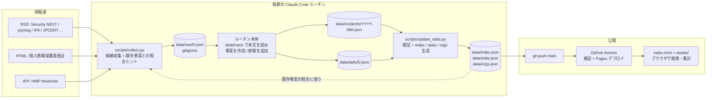

# data-leak-search 設計書（v0.2 ドラフト）

最終更新: 2026-10-17
ステータス: ドラフト（レビュー待ち）
前提: [ke-iwata/tech-research](https://github.com/ke-iwata/tech-research) と同じ作り（ビルド不要の静的サイト + 標準ライブラリのみの Python スクリプト + Claude Code のルーチンによる日次更新 + GitHub Pages）

---

## 0. この文書の目的

情報漏洩（データブリーチ）に関する公開情報を毎日集め、事案（Incident）単位に整理して検索・追跡できるサイトの設計をまとめる。
tech-research の構成を踏襲しつつ、「記事の日次ダイジェスト」ではなく「事案の台帳」を蓄積する点が主な違い。

---

## 1. スコープと前提

### 1.1 扱う情報

| 種別 | 例 |
|---|---|
| 組織の公式発表 | 「不正アクセスによる個人情報漏えいの可能性について」等のプレスリリース・お知らせ |
| 公的機関の公表・注意喚起 | 個人情報保護委員会（PPC）、IPA、JPCERT/CC |
| 専門メディア・まとめ | Security NEXT、piyolog、ScanNetSecurity、海外は BleepingComputer 等（v1） |
| 既存の漏洩メタデータ | Have I Been Pwned（HIBP）の breaches API（無料・キー不要） |
| リークサイト観測（v1、要検討） | ransomware.live の公開 API（被害組織名・グループ・日付のメタデータのみ） |

### 1.2 扱わない情報 — 重要

- **漏洩したデータそのもの**（個人情報・認証情報・ダンプ）は収集・保存・表示しない。
- ダークウェブやリークサイトの実データを取得・ミラーしない。
- **個人を名指ししない**。事案の主体は組織のみ。内部不正の従業員名、被害者名、報道に出た個人名は記録しない。
- 「このメールアドレスが漏れたか」の確認機能は持たない（HIBP へのリンクに留める）。

理由: 法的リスク（不正アクセス禁止法・個人情報保護法）と倫理面。メタデータ集約だけで「どこで・いつ・何が・どれだけ・なぜ」は把握できる。

### 1.3 想定ユーザー

まず自分用（セキュリティ動向の把握、設計の参考事例の検索）。公開はするが tech-research 同様 `noindex`。
将来的に、取引先や利用 SaaS の漏洩履歴を調べたい人、業種別・原因別の傾向を調べたい人にも使えるようにする。

### 1.4 制約

- 1 人・副業時間・ランニングコストはほぼゼロ（GitHub Pages + ルーチン実行のみ）。
- サーバもビルドも持たない。すべて `data/*.json` を静的に配信し、ブラウザ側で検索・集計する。
- 日本の事案を主、海外を従として開始する。
- 情報源は公開情報のみ。機械収集が禁止されているサイトは RSS / API がある場合に限る。

---

## 2. 要件

### 2.1 機能要件

**MVP**
- F1. 収集スクリプトが RSS / API から漏洩関連の候補記事を集め、既存事案との照合ヒントを付けて `data/raw/D.json` に書く
- F2. 日次ルーチン（Claude Code）が候補を読み、事案の新規作成または既存事案への続報追加を行い、`data/incidents/` を更新する
- F3. 検証・集計スクリプトが事案ファイルを検証し、一覧用インデックスと統計を生成する
- F4. サイト: 今日のブリーフ（新規・続報・要点）、事案の検索一覧（ファセット付き）、事案詳細（タイムライン・出典）、組織ページ、統計
- F5. 公開前の自動検証（GitHub Actions）と Pages デプロイ

**v1**
- F6. 海外ソース（HIBP は MVP から、メディアは v1）、ransomware.live 観測情報（`unconfirmed` 扱い）
- F7. ウォッチ機能（ブラウザの localStorage に組織・キーワードを保存し、新着を強調表示。通知は持たない）
- F8. JSON をそのまま公開 API として案内（`data/index.json`、`data/incidents/YYYY-MM.json`）

**v2 以降**
- F9. 類似事案（原因・業種・データ種別の一致による「関連事案」）
- F10. 年次レポート（年間統計の自動生成）

### 2.2 非機能要件

| 項目 | 目標 |
|---|---|
| データ量 | 日本の公表事案は年 1,000〜2,000 件。5 年で 1 万件。インデックス 1 件 300 バイト前後 → `index.json` は 3MB 程度（gzip 後 数百 KB） |
| 初期表示 | `index.json` と当日ファイルのみ読み、事案本体は月別ファイルを遅延読込。初期表示 1 秒以内 |
| 鮮度 | 1 日 1 回（朝）。公表から翌朝までに掲載 |
| 正確性 | 事案には必ず一次出典（組織の発表 or 公的機関）または信頼できるメディアの URL を付ける。本文未読の項目は `confidence` を下げ、UI で「未確認」表示 |
| コスト | GitHub Pages 無料枠。ルーチンは Claude Code の実行枠内 |
| 公開リポジトリ | 持ち主の個人情報を書かない。事案に個人名を書かない |

---

## 3. 全体アーキテクチャ



### 3.1 役割分担

| 担当 | やること | やらないこと |
|---|---|---|
| `collect.py`（Python、標準ライブラリのみ） | RSS / API 取得、漏洩キーワードによる足切り、既存事案との照合ヒント（組織名・日付の近さ） | 本文の読解、分類の確定 |
| ルーチン（Claude Code、`CLAUDE.md` の手順） | 候補の取捨選択、WebFetch で一次出典を読む、構造化（原因・件数・データ種別・日付）、新規 or 続報の判断、要約 | 推測で数値を埋めること、個人名の記録 |
| `update_stats.py`（Python） | スキーマ検証、`index.json` / `stats.json` / `orgs.json` 生成 | 内容の判断 |
| `index.html` + `assets/` | 検索・ファセット・詳細・統計の描画（すべてブラウザ側） | サーバ処理 |
| GitHub Actions | `claude/**` → `main` マージ、`--check-only` 検証、Pages デプロイ | 収集（ルーチン環境で行う） |

### 3.2 tech-research との違い

| 観点 | tech-research | data-leak-search |
|---|---|---|
| 蓄積の単位 | 日次ファイル（記事はその日限り） | 事案ファイル（月別）。日次ファイルは「その日の差分と要点」 |
| 同じ話題の扱い | 1 件にまとめて終わり | 既存事案への**続報として追記**（件数の更新、原因の確定、報告書公表） |
| 名寄せ | キーワード slug | 組織 slug（`org`）を同じ流儀で統一。`orgs.json` で履歴を引ける |
| 集計 | キーワードのリング | 月次件数、原因別、業種別、データ種別別、規模分布 |
| 画面 | TODAY / READ / RADAR / MARKET | TODAY / INCIDENTS / ORGS / STATS |

---

## 4. ファイル構成

| パス | 内容 | 書き手 | commit |
|---|---|---|---|
| `index.html`, `assets/app.js`, `assets/style.css` | サイト本体（tech-research のポスター様式を踏襲） | 人 | する |
| `CLAUDE.md` | 日次更新ルーチンの手順、スキーマ、運用ルール | 人 | する |
| `data/config.json` | 情報源、原因・業種・データ種別のマスタ、漏洩キーワード、除外ルール | 人 | する |
| `data/raw/YYYY-MM-DD.json` | 収集した候補（下書き） | `collect.py` | **しない** |
| `data/incidents/YYYY-MM.json` | 事案の台帳。`disclosed_at` の月で分割 | ルーチン | する |
| `data/daily/YYYY-MM-DD.json` | その日の要点・新規/続報の事案 id・収集統計 | ルーチン | する |
| `data/index.json` | 全事案の軽量インデックス（一覧・検索用） | `update_stats.py` | する |
| `data/stats.json` | 月次・原因別・業種別などの集計 | `update_stats.py` | する |
| `data/orgs.json` | 組織 slug → 表示名・別名・事案 id 一覧 | `update_stats.py` | する |
| `data/state/seen.json` | 処理済み URL（content hash 付き）。再掲防止 | `collect.py` / ルーチン | する |
| `scripts/collect.py` | 収集 | 人 | する |
| `scripts/update_stats.py` | 検証・集計 | 人 | する |
| `.github/workflows/pages.yml` | tech-research と同じ（claude/** → main マージ → Pages） | 人 | する |

---

## 5. データスキーマ

### 5.1 `data/config.json`（抜粋）

```json
{
  "title": "data-leak-search",
  "timezone": "Asia/Tokyo",
  "causes": [
    {"id": "unauthorized_access", "label": "不正アクセス", "color": "#C8200A"},
    {"id": "ransomware",          "label": "ランサムウェア", "color": "#7A1FA2"},
    {"id": "misconfiguration",    "label": "設定不備・公開設定ミス", "color": "#1849B8"},
    {"id": "email_misdelivery",   "label": "メール誤送信", "color": "#E3B341"},
    {"id": "lost_device",         "label": "紛失・盗難", "color": "#2DD4BF"},
    {"id": "insider",             "label": "内部不正・持ち出し", "color": "#F778BA"},
    {"id": "third_party",         "label": "委託先・外部サービス起因", "color": "#58A6FF"},
    {"id": "other",               "label": "その他・不明", "color": "#8A8A8A"}
  ],
  "industries": [
    {"id": "public",     "label": "官公庁・自治体"},
    {"id": "education",  "label": "教育"},
    {"id": "medical",    "label": "医療・福祉"},
    {"id": "finance",    "label": "金融・保険"},
    {"id": "retail",     "label": "小売・EC"},
    {"id": "manufacturing", "label": "製造"},
    {"id": "it",         "label": "IT・通信"},
    {"id": "service",    "label": "サービス・その他"}
  ],
  "data_types": [
    {"id": "name", "label": "氏名"}, {"id": "address", "label": "住所"}, {"id": "phone", "label": "電話番号"},
    {"id": "email", "label": "メールアドレス"}, {"id": "birthday", "label": "生年月日"},
    {"id": "credential", "label": "ID・パスワード"}, {"id": "card", "label": "クレジットカード"},
    {"id": "bank", "label": "口座情報"}, {"id": "mynumber", "label": "マイナンバー"},
    {"id": "health", "label": "健康・医療情報"}, {"id": "internal_doc", "label": "社内文書・取引情報"},
    {"id": "other", "label": "その他"}
  ],
  "leak_keywords": ["漏えい", "漏洩", "流出", "不正アクセス", "ランサムウェア", "紛失", "誤送信", "誤公開", "閲覧可能", "breach", "leak", "ransomware"],
  "exclude_keywords": ["脆弱性情報", "セミナー", "製品紹介"],
  "sources": [
    {"id": "security_next", "name": "Security NEXT", "kind": "rss", "trust": "media",
     "url": "https://www.security-next.com/feed"},
    {"id": "piyolog", "name": "piyolog", "kind": "rss", "trust": "media",
     "url": "https://piyolog.hatenadiary.jp/rss"},
    {"id": "ipa", "name": "IPA", "kind": "rss", "trust": "authority", "url": "https://www.ipa.go.jp/security/rss/..."},
    {"id": "jpcert", "name": "JPCERT/CC", "kind": "rss", "trust": "authority", "url": "https://www.jpcert.or.jp/rss/jpcert.rdf"},
    {"id": "ppc", "name": "個人情報保護委員会", "kind": "html", "trust": "authority", "url": "https://www.ppc.go.jp/news/..."},
    {"id": "hibp", "name": "Have I Been Pwned", "kind": "hibp", "trust": "aggregator",
     "url": "https://haveibeenpwned.com/api/v3/breaches"}
  ]
}
```

- `trust` は `official`（組織自身）/ `authority`（公的機関）/ `media` / `aggregator`。出典の表示順と `confidence` の初期値に使う
- 実際の URL は `collect.py --dry-run` で取得できることを確認してから登録する（tech-research と同じ運用）

### 5.2 `data/incidents/YYYY-MM.json`（事案の台帳）

```json
{
  "month": "2026-10",
  "incidents": [
    {
      "id": "2026-10-01-sample-corp",            // disclosed_at-org。一意
      "org": "sample-corp",                       // 組織 slug。orgs.json のキー。既存 slug を優先して再利用する
      "org_name": "株式会社サンプル",
      "org_aliases": ["サンプル", "Sample Corp."],
      "industry": "retail",                       // config.industries[].id
      "country": "JP",
      "title": "株式会社サンプル 不正アクセスによる顧客情報漏えい",
      "summary": "EC サイトが不正アクセスを受け、顧客情報 12 万件が漏えいした可能性。クレジットカード情報を含む。",  // 2〜3 文
      "cause": "unauthorized_access",             // config.causes[].id
      "vector": "ECサイトの脆弱性を突かれ決済ページを改ざん",  // 原因の具体（分かる範囲、null 可）
      "data_types": ["name", "address", "card"],  // config.data_types[].id
      "affected": 123456,                         // 判明している件数。不明なら null
      "affected_is_estimate": false,              // 「最大」「可能性」表記なら true
      "occurred_at": "2026-08-10",                // 発生（期間なら開始日）。不明なら null
      "detected_at": "2026-09-20",
      "disclosed_at": "2026-10-01",               // 最初の公表日。ファイルの月はこれで決まる
      "status": "disclosed",                      // disclosed / investigating / reported / closed / unconfirmed
      "confidence": 0.9,                          // 0〜1。一次出典を本文まで読めたら 0.9、メディアのみ 0.7、見出しのみ 0.5
      "sources": [
        {"role": "primary", "trust": "official", "publisher": "株式会社サンプル",
         "url": "https://example.co.jp/news/2026/1001.html", "published_at": "2026-10-01", "title": "..."},
        {"role": "secondary", "trust": "media", "publisher": "Security NEXT",
         "url": "https://www.security-next.com/...", "published_at": "2026-10-02", "title": "..."}
      ],
      "timeline": [
        {"date": "2026-08-10", "kind": "occurred",  "text": "不正アクセスの開始（推定）", "source": 0},
        {"date": "2026-09-20", "kind": "detected",  "text": "決済代行会社からの連絡で判明", "source": 0},
        {"date": "2026-10-01", "kind": "disclosed", "text": "第一報を公表。EC サイトを停止", "source": 0},
        {"date": "2026-10-15", "kind": "updated",   "text": "件数を 12 万件に修正。カード情報を含むと発表", "source": 2}
      ],
      "keywords": ["ec-site", "payment-skimming"], // 小文字 slug。既存 slug を優先
      "created_at": "2026-10-02",
      "updated_at": "2026-10-16"
    }
  ]
}
```

- `timeline.kind` は `occurred` / `detected` / `disclosed` / `updated` / `report_filed`（当局へ報告・報告書公表）/ `resolved`
- `timeline.source` は `sources` 配列のインデックス
- 続報が来たら: `sources` に追加、`timeline` に `updated` を足し、`affected` / `cause` / `data_types` / `status` を更新、`updated_at` を更新する。**上書き前の値は timeline の text に残す**（「件数を 5 万件から 12 万件に修正」）
- `status: "unconfirmed"` は組織の公表が確認できていないもの（v1 のリークサイト観測など）。UI では一覧の既定フィルタから外す

### 5.3 `data/daily/YYYY-MM-DD.json`（その日の差分）

```json
{
  "date": "2026-10-17",
  "generated_at": "2026-10-17T06:10:00+09:00",
  "stats": {"collected": 84, "candidates": 19, "sources_ok": 6, "sources_total": 6, "failed_sources": []},
  "digest": [
    {"text": "小売の EC サイト改ざんによるカード情報漏えいが今週 3 件。いずれも決済ページへのスクリプト埋め込み。", "incidents": ["2026-10-01-sample-corp", "..."]}
  ],
  "new": ["2026-10-16-foo-city", "2026-10-16-bar-hospital"],       // 今日作った事案 id
  "updated": [{"id": "2026-10-01-sample-corp", "text": "件数を 12 万件に修正"}],
  "skipped": [{"url": "https://...", "reason": "脆弱性情報で事案ではない"}]  // 判断の記録（任意、5 件まで）
}
```

### 5.4 生成ファイル（`update_stats.py` が作る。手で書かない）

- `data/index.json`: 全事案の軽量版 `{id, org, org_name, industry, country, title, cause, data_types, affected, disclosed_at, status, confidence, month, n_sources}` の配列 + `generated_at` + `months`（存在する月の一覧）
- `data/stats.json`: `monthly[]`（月ごとの件数・原因別・業種別）、`by_cause`、`by_industry`、`by_data_type`、`scale_buckets`（〜1 千 / 〜1 万 / 〜10 万 / 〜100 万 / 100 万〜）、`top_affected[]`（直近 1 年の規模上位）、`recent_days[]`（直近 30 日の新規・続報件数）
- `data/orgs.json`: `{slug: {name, aliases, industry, incidents: [id...], first, last}}`

---

## 6. 収集スクリプト `scripts/collect.py`

tech-research の `collect.py` をベースに、次を変える。

1. **足切り**: タイトル + 要約に `leak_keywords` のいずれかを含み、`exclude_keywords` を含まないものだけ候補にする。`leak_score`（ヒット数）を付ける
2. **HIBP**: `/api/v3/breaches` を取得し、`AddedDate` が `--hours` 以内のものを候補にする（`kind: "hibp"`）
3. **PPC**: RSS が無いため HTML を取得し、一覧の `<a>` から「漏えい」「公表」を含むリンクを抜く（セレクタは `config` に持つ）
4. **既存事案との照合ヒント**: `data/index.json` と `data/orgs.json` を読み、候補のタイトルに含まれる組織名（`org_name` / `org_aliases`）と `disclosed_at` ±30 日で一致する事案 id を `maybe_update_of: ["2026-10-01-sample-corp"]` として付ける。ルーチンはこれを見て新規か続報かを判断する（最終判断はルーチン）
5. **処理済み判定**: `data/state/seen.json` にある URL は `seen: true` を付ける（候補からは外さない。続報の判断材料として残す）
6. **出力**: `data/raw/D.json` に `{date, collected_at, source_status, count, candidates: [...]}`。候補は `leak_score` と `maybe_update_of` の有無で並べ替える

HTML 抽出のための外部ライブラリは入れない（標準ライブラリの `html.parser` で足りる範囲に留める）。

---

## 7. 日次ルーチン（`CLAUDE.md` に書く手順の骨子）

Claude Code のルーチン（スケジュールされたタスク）から「CLAUDE.md の日次更新ルーチンを実行して」と呼ばれる前提。無人実行なので質問はせず、判断した前提は `daily` の `skipped` や timeline の text に残す。

0. **main から始める**: `git fetch origin main && git checkout -B main origin/main`
1. **収集**: `python3 scripts/collect.py`。失敗したソースは `daily.stats.failed_sources` に書く
2. **候補の選別**: `data/raw/D.json` の候補を上から見る。
   - 事案ではないもの（脆弱性情報、注意喚起のみ、製品記事）は `skipped` に理由を書いて捨てる
   - `maybe_update_of` があるものは、既存事案を開いて同一事案か確かめる（組織・時期・原因が一致すれば続報）
3. **一次出典を読む**: メディア記事の場合、本文中の組織の発表 URL を探して **WebFetch で本文を読む**。読めたら `role: "primary"` として `sources` に入れ、`confidence: 0.9`。メディアのみなら 0.7、見出しだけなら 0.5
4. **構造化**: 5.2 のスキーマで事案を書く。
   - `affected` は本文に書かれた数字だけ。「最大」「可能性」「約」は `affected_is_estimate: true`。無ければ `null`
   - 日付は本文で確認できたものだけ。推測しない
   - `org` slug は `orgs.json` の既存を最優先。新規なら小文字英数字とハイフン（例 `sample-corp`, `foo-city`, `bar-hospital`）
   - 個人名は書かない。組織名のみ
   - `cause` / `industry` / `data_types` は `config.json` の id のみ使う
5. **新規 or 続報**:
   - 新規: `data/incidents/YYYY-MM.json`（`disclosed_at` の月）に追加。無ければファイルを作る
   - 続報: 該当事案の `sources` / `timeline` / 更新項目を書き換え、`updated_at` を更新。**変更前の値を timeline の text に残す**
6. **`data/daily/D.json` を書く**: `digest`（1〜5 件。その日の傾向や大規模事案を 1〜2 文で）、`new`、`updated`、`skipped`
7. **`data/state/seen.json`** に処理した URL を追加する
8. **検証・集計・push**:
   ```bash
   python3 scripts/update_stats.py        # エラーなら直してやり直す
   git add -A
   git commit -m "data: D 日次更新（新規N件・続報N件）"
   git push origin HEAD:main              # 拒否されたら pull --rebase → update_stats.py → push
   ```
   main に push できない時だけ `claude/` ブランチに push する（Actions が main にマージして公開する）
9. **最終メッセージ**: digest と新規・続報の一覧を出す

ルーチンの 1 回あたりの目安: 候補 10〜30 件、新規 0〜10 件、続報 0〜5 件、WebFetch 10〜20 回。

---

## 8. 画面設計

**採用デザイン: B案「OPS ダーク」**（デザインキャンバス: https://claude.ai/artifact/8zn3LYpFGb7CrKcewjpB4y ）。
tech-research の `index.html` / `app.js` から状態管理・描画ヘルパ・日付ナビ・検索・localStorage の仕組みを流用し、見た目（`style.css`）は B案のトークンに差し替える。

### 8.1 デザイントークン

| 役割 | 値 |
|---|---|
| 地色 / レール / カード / 罫線 | `#1a1a19` / `#121211` / `#222221` / `#2c2c2a` |
| 文字（主 / 副 / 控えめ） | `#f0efec` / `#c3c2b7` / `#8f8e86` |
| アクセント（選択・リンク・単一系列の棒） | `#3987e5`（淡: `#9ec5f4`、地: `#2a3a52`） |
| 注意（続報・推定・SAMPLE） | 文字 `#f3c969`、地 `#3a2f12` |
| 要配慮データ（カード・口座・医療 等） | 文字 `#f0a0a0`、地 `#4a1f1f` |
| 原因色（固定順・ダーク面用） | 不正アクセス `#3987e5` / 誤送信・誤公開 `#199e70` / ランサムウェア `#d95926` / 紛失・盗難 `#c98500` / 内部不正 `#d55181` / その他 `#8a8a8a` |
| 日次件数ヒートマップ（0→8 件） | `#232322` `#0d366b` `#104281` `#184f95` `#1c5cab` `#256abf` `#2a78d6` `#3987e5` `#5598e7` |
| フォント | 本文 IBM Plex Sans JP、数値・日付・ラベル IBM Plex Mono |

原因色は色覚多様性（隣接ペアの CVD ΔE ≥ 8）と明度差の検証を通した組み合わせ。色だけに頼らず、常にラベルと点を併記する。

### 8.2 共通シェル

- 左レール 84px: DLS ロゴ、TODAY / INCIDENTS / ORGS / STATS / WATCH。現在画面は `aria-current="page"`
- スマホでは下タブに折りたたむ（tech-research の `.bnav` と同じ）
- 右上に `SAMPLE DATA` 相当の場所へ「最終更新 HH:MM JST · ソース n/m」を出す
- 検索ボックスは `/` でフォーカス。対象は `index.json` の `title` / `org_name` / `org_aliases` / `summary`

### 8.3 画面一覧

| 画面 | 内容 | 読むファイル |
|---|---|---|
| **TODAY** `#today` | ヒーロー数字「本日の影響人数（判明分）」+ 上位 2 件の内訳。新規 / 続報 / 直近 30 日の件数タイル（新規には直近 7 日のミニ棒）。期間切替 7D / 30D / 90D / 1Y。13 週 × 曜日の**日次件数ヒートマップ**（今日のセルに白枠、凡例 0〜8 件）。原因別の積み上げバー + 一覧 + 業種別上位 4。本日のフィード（時刻・原因点・組織・要約・影響人数・NEW / UPDATE / REPORT バッジ）。直近 1 年の影響規模ランキング（メーター付き） | `daily/D.json`, `index.json`, `stats.json` |
| **INCIDENTS** `#incidents` | 検索 + 絞り込みチップ（期間 / データ種別 / 規模 …、× で解除）。左ファセット: 期間（30D/90D/1Y/ALL + 日付範囲）、原因（色点 + 件数）、業種、影響人数（分布ミニヒストグラム + 〜1 千 / 〜1 万 / 1 万〜 / 不明のみ）、確認状態（一次出典あり / メディアのみ / 未確認を含める）。一覧は行形式: 公表日（NEW / 更新 MM-DD）・組織と要約・原因・データ・影響人数（推定表示）・出典数（◆ 一次 / ◇ メディア）。並び替え: 公表日 / 影響人数 / 更新日。「この条件を JSON で取得」 | `index.json` |
| **事案詳細** `#incident/<id>` | パンくず（INCIDENTS / 月 / id）。ヘッダ: 原因・業種・国・確認状態（一次出典あり · 確信度）・ステータスのチップ、見出し、要約、「この組織をウォッチ」「JSON」。主要項目の `dl`: 影響人数 / 発生 / 検知 / 公表 / データ種別（要配慮は赤チップ）/ 経路。各値に出典番号 `[n]`。左: タイムライン（OCCURRED / DETECTED / DISCLOSED / NEXT、続報は追記）。右: 出典（PRIMARY を上、trust バッジ、URL）、同じ組織の他事案、似た事案（同じ原因 × データ種別）。フッタに「誤りを報告（GitHub Issue）」 | `incidents/YYYY-MM.json` を遅延読込 |
| **ORGS** `#orgs`, `#org/<slug>` | 左: 組織一覧（事案数 / 最終公表 / 累計影響で並び替え、業種フィルタ）。右: 組織ページ（slug・別名・業種・国、ウォッチ切替、事案数 / 累計影響 / 初出と最終 / 原因内訳、年表（点の大きさ = 影響人数、縁取り = 直近 30 日に更新）、事案履歴） | `orgs.json`, `index.json` |
| **STATS** `#stats` | 期間 1Y / 3Y / ALL、CSV。タイル: 事案数 / 影響人数合計 / 影響人数中央値 / 発生から公表まで中央値。月次件数の縦棒（当月は枠線のみ、最大と最小と当月に値ラベル）。原因別 / 業種別の横棒、影響人数の分布（5 区分）、データ種別の割合、影響規模上位 10 件の表 | `stats.json` |

### 8.4 UI の方針

- **出典を前面に**: 数値・日付の横に出典番号を置き、クリックで出典カードへ。出典カードは PRIMARY / SECONDARY と trust を明示
- **未確認・推定を明示**: `confidence < 0.7` は「メディアのみ」バッジ、`affected_is_estimate` は「推定」、`status: unconfirmed` は既定で非表示（ファセットで表示可）
- **続報が分かる**: 一覧とランキングに「更新 MM-DD」、TODAY のフィードに UPDATE / REPORT バッジ。詳細のタイムラインは上書きせず追記
- **要配慮データを区別**: カード・口座・医療・マイナンバー・認証情報は赤系チップ。原因色とは別系統にして混同を避ける
- **煽らない**: 中立・事務的。組織名は公表事実のみ。個人名は出さない
- **グラフの作法**: 棒は 24px 以下・先端 4px 丸め、2 系列以上は必ず凡例、文字は系列色を着ない、二軸グラフは使わない
- ウォッチ（v1）: 組織 slug / キーワードを localStorage に持ち、TODAY と INCIDENTS で該当行を強調。tech-research の `store` と同じ作り

## 9. 公開フロー

`.github/workflows/pages.yml` は tech-research のものをそのまま使う。

- `main` への push → `update_stats.py --check-only` で検証 → Pages デプロイ
- `claude/**` への push → `main` にマージ → 検証 → `main` を対象に再実行して公開 → `claude/**` を削除
- 検証に失敗したら公開しない（壊れたデータを出さない）

ローカル確認: `python3 -m http.server` → http://localhost:8000

---

## 10. 技術的判断とトレードオフ

| 判断 | 採用 | 捨てたもの | 理由・限界 |
|---|---|---|---|
| 保存 | git 管理の JSON（月別） | PostgreSQL | サーバ不要・履歴が git に残る・tech-research と同じ運用。限界: 1 ファイルが数百 KB を超える月は無い想定（月 200 件 × 1.5KB = 300KB） |
| 検索 | ブラウザ側の部分一致 + ファセット | Meilisearch | 1 万件・3MB なら十分速い。限界: 表記ゆれ・同義語には弱い → `org_aliases` と `keywords` slug で補う |
| 抽出 | ルーチン（Claude Code）が WebFetch して構造化 | 自前の LLM パイプライン | 実行基盤もコストも持たなくて済む。限界: 1 日 1 回、1 回に扱える候補は 30 件程度 |
| 名寄せ | 組織 slug を手で統一（既存優先） | 法人番号 API | 運用で十分。限界: 初期はゆれが出る → `orgs.json` を見て直す |
| 重複判定 | `collect.py` のヒント + ルーチンの判断 | 自動マージ | 誤統合より見落としの方がまし。ヒントは出すが決めない |
| 通知 | 持たない（v1 で localStorage の強調のみ） | メール / Slack | サーバが無い。必要なら GitHub Actions から Slack Webhook を叩く案を v2 で |

**見直すタイミング**
- `index.json` が 10MB を超えたら年別インデックスに分割する
- 月の事案が 300 件を超え続けたら旬別ファイルに分割する
- 候補が 1 日 50 件を超えたら `collect.py` 側の足切りを強める（`leak_score` の閾値、ソースごとの上限）
- 海外ソースを足すと英語の組織名・業種分類の問題が出る → `country` ごとの industry マッピングを config に持つ

---

## 11. 法務・倫理・運用ポリシー

- **掲載基準**: 組織自身・公的機関・信頼できるメディアのいずれかが公表した事案のみ。噂や未確認のリーク主張は載せない。リークサイト観測（v1）は `unconfirmed` とし、組織の公表が確認できたら通常の事案に昇格する
- **個人情報**: 個人名・個人のメールアドレス等は一切書かない。`update_stats.py` でメールアドレスとカード番号のパターンを検査し、検出したら検証エラーにする
- **著作権**: 記事本文は転載しない。`summary` は自分の言葉で 2〜3 文、`timeline.text` は事実の要約のみ
- **訂正**: 詳細ページから GitHub Issue へ誘導。一次出典が訂正・削除された場合は追随する（`status: closed` + timeline に記録）
- **利用規約**: 機械収集が禁止されたサイトは RSS / API のみ。`User-Agent` にリポジトリ URL を入れる
- **免責**: 公開情報の集約であり正確性を保証しない旨を `index.html` のフッタに明記

---

## 12. ロードマップ

| フェーズ | 期間目安 | ゴール |
|---|---|---|
| M0 設計 | 今 | 本書のレビュー |
| M1 骨格 | 1〜2 週 | `config.json`、`collect.py`（Security NEXT / piyolog / HIBP）、`update_stats.py`、`CLAUDE.md`、`pages.yml`。手動で 1 回ルーチンを回して 1 週間分の事案を作る |
| M2 サイト | 1〜2 週 | TODAY / INCIDENTS / 詳細 / ORGS / STATS。tech-research の `app.js` から共通部分（状態・描画ヘルパ・日付ナビ・検索）を流用 |
| M3 運用開始 | — | ルーチンをスケジュール登録。2 週間回して slug のゆれ・抽出の癖を `CLAUDE.md` に反映 |
| v1 | +1〜2 か月 | PPC・IPA・JPCERT ソース、ウォッチ、ransomware.live（unconfirmed） |
| v2 | 以降 | 関連事案、年次レポート、Actions からの通知 |

---

## 13. 未決事項

1. **リポジトリの `main` ブランチ**: まだ存在しない。`pages.yml` は `main` 前提なので、最初に `main` を作る必要がある（この作業ブランチから作ってよいか）
2. **公開範囲**: tech-research 同様 `noindex` の自分用で始めるか、検索エンジンに載せるか。載せるなら訂正窓口の明示が先
3. **海外事案の深さ**: HIBP の breach は MVP から入れるが、`industry` / `cause` の付与は HIBP の説明文からの推定になる。`confidence: 0.6` で入れるか、v1 まで待つか
4. **ランサムウェアのリークサイト観測**: `unconfirmed` として載せる価値があるか。企業名が出る分、誤りのリスクも上がる
5. **ルーチンの時刻**: tech-research と同じ朝 5〜6 時台でよいか。企業の発表は夕方が多いため、前日夕方分を翌朝に拾う形になる
